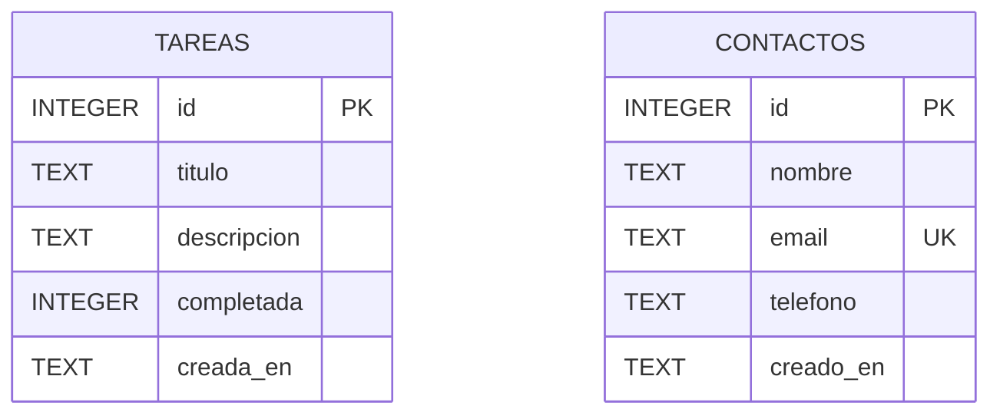

# Modelo de datos

La API usa SQLite con dos tablas independientes (no hay relación entre tareas y contactos en este taller).

## Tabla `tareas`

| Columna | Tipo | Restricciones | Descripción |
|---|---|---|---|
| id | INTEGER | PK, AUTOINCREMENT | Identificador |
| titulo | TEXT | NOT NULL | Título de la tarea |
| descripcion | TEXT | DEFAULT '' | Detalle opcional |
| completada | INTEGER | NOT NULL, DEFAULT 0 | 0 = pendiente, 1 = completada (la API la expone como booleano) |
| creada_en | TEXT | DEFAULT CURRENT_TIMESTAMP | Fecha de creación |

## Tabla `contactos`

| Columna | Tipo | Restricciones | Descripción |
|---|---|---|---|
| id | INTEGER | PK, AUTOINCREMENT | Identificador |
| nombre | TEXT | NOT NULL | Nombre completo |
| email | TEXT | NOT NULL, UNIQUE | Correo (no se repite) |
| telefono | TEXT | DEFAULT '' | Teléfono opcional |
| creado_en | TEXT | DEFAULT CURRENT_TIMESTAMP | Fecha de creación |

## Diagrama

## Decisiones

- `completada` se guarda como entero porque SQLite no tiene tipo booleano.
- `email` es único para evitar contactos duplicados (la API responde 409).
